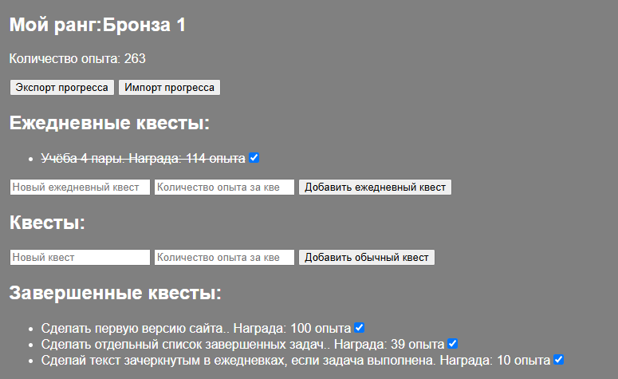

# QuestLog

Геймифицированный трекер задач: выполняешь квесты — получаешь опыт — растёшь в ранге.



## Что это

QuestLog превращает обычный список дел в RPG-прокачку. Есть ежедневные и обычные квесты, за каждый даётся опыт, опыт повышает ранг. Всё работает в браузере, без регистрации, без сервера.

## Возможности

- Выбор количества опыта за квест
- Ранги по опыту: Бронза 3 → Легенда 1
- Прогресс сохраняется между перезагрузками (`localStorage`)
- Экспорт и импорт прогресса в JSON-файл
- Отрисовка интерфейса из данных
- Без фреймворков, без сборки, без backend — чистые HTML, CSS и JavaScript

## Демо

**[Открыть QuestLog](https://ceftan.github.io/questlog)**


## Технологии

- HTML5
- CSS3 
- JavaScript 
- `localStorage` для хранения
- `File API` (`Blob`, `FileReader`) для экспорта/импорта

## Как запустить локально

1. Склонируй репозиторий:
   ```
   git clone https://github.com/ceftan/questlog.git
   ```
2. Открой `index.html` в браузере — всё.

Сборка и установка зависимостей не нужны.

## Как это устроено

Задачи хранятся в массиве объектов в памяти:

```js
{
  text: "Помыть посуду",
  type: "quest",   // "daily" или "quest"
  xp: 10,            // сколько XP даётся
  done: false        // выполнено ли
}
```

При любом изменении (добавили квест, отметили выполнение) массив сохраняется в `localStorage`, а интерфейс перерисовывается из массива. 

## Формула рангов

| XP | Ранг |
|---|---|
| 0–99 | Бронза 3 |
| 100-249 | Бронза 2 |
| 250-499 | Бронза 1 |
| 500–799 | Серебро 3 |
| 800-1199 | Серебро 2 |
| 1200-1799 | Серебро 1 |
| 1800-2499 | Золото 3 |
| 2500-3299 | Золото 2 |
| 3300-4299 | Золото 1 |
| 4300-5499 | Платина 3 |
| 5500-6999 | Платина 2 |
| 7000-8999 | Платина 1 |
| 9000-11499 | Алмаз 3 |
| 11500-14499 | Алмаз 2 |
| 14500-17999 | Алмаз 1 |
| 18000-21999 | Легенда 3 |
| 22000-26999 | Легенда 3 |
| 27000+ | Легенда 1 |


## Планы
- [x] Добавление нормальной системы рангов(более менее готово)
- [x] Адаптировать сайт под телефоны
- [x] Добавить раздел с завершенными квестами
- [ ] Автоматический сброс ежедневных квестов по дате
- [ ] Добавить разные шкалы опыта
- [ ] Калькулятор опыта
- [ ] Удаление квестов
- [ ] Серия дней подряд (streak)
- [ ] Статистика по дням
- [ ] Прогресс-бар
- [ ] и очень многое другое.
